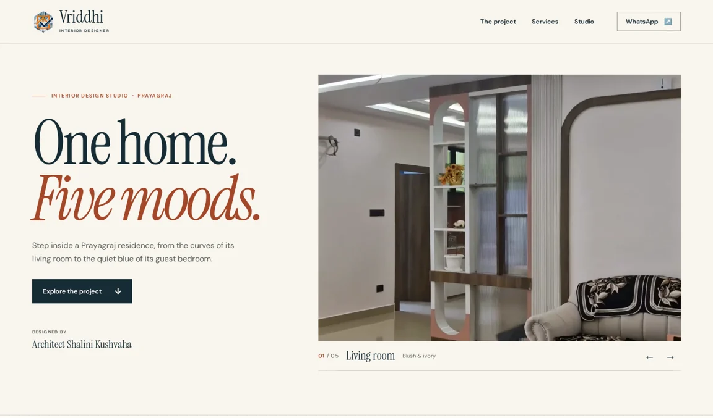

# Vriddhi Interior Designer

A static Next.js portfolio for the studio’s interior design services in Prayagraj. The room gallery and design details use photographs extracted from the studio’s marketing reel.

## Local development

Use Node.js 22 or later. Run `npm ci`, then `npm run dev`. To generate the production site in `out/`, run `npm run build`.

## Vercel

Import this repository and select the Next.js framework preset. The site builds as a static export. All project images and fonts are served with the site. Enquiry buttons open WhatsApp with the chosen service and location already filled in.

## Content

Room captions, design details, service descriptions and WhatsApp messages are in `app/project.js`. The landing page and office details are in `app/page.jsx`. Responsive project photographs are in `public/images/`.
